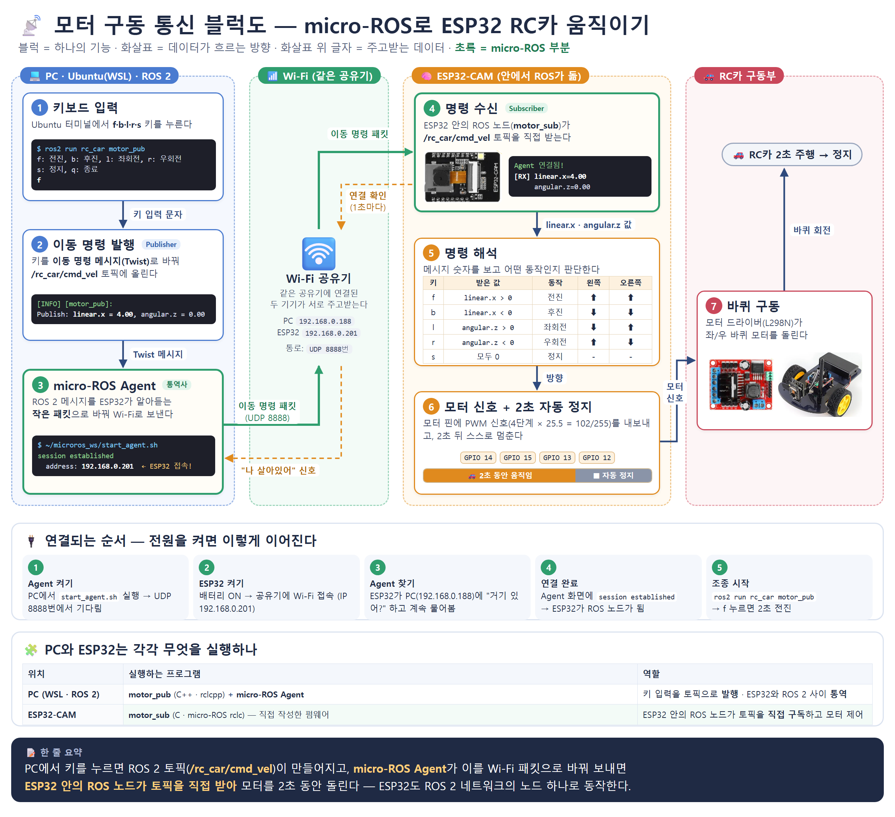
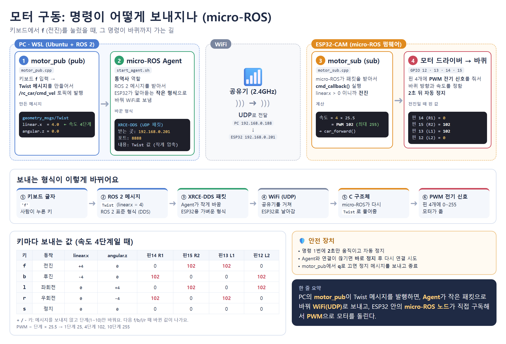
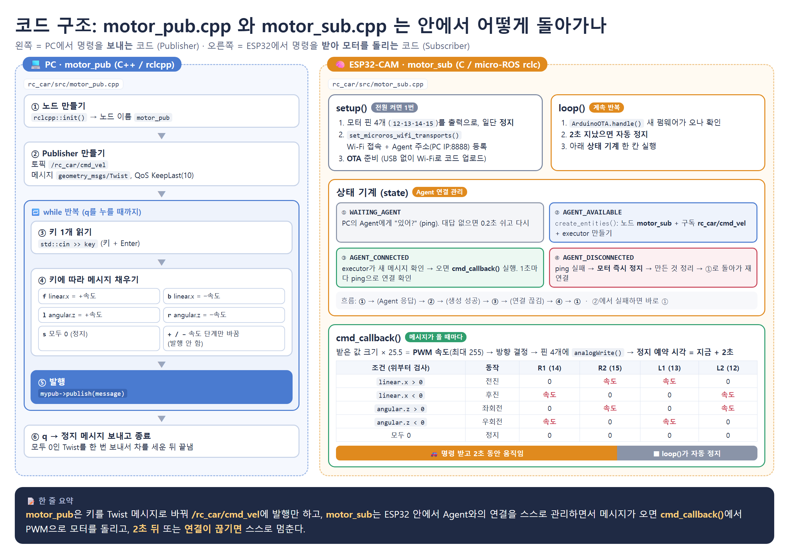

# 구현 1 (11/30): 모터 구동, ROS 2 + micro-ROS로 ESP32 RC카 움직이기

> **이번 구현의 범위**: RC카를 **주행시키는 부분(모터)**. 키보드 명령, ROS 2 토픽, Wi-Fi, ESP32, 모터 순서로 이어지는 전체 경로를 다룹니다.
> LED와 카메라는 따로 만들어 테스트하는 중이라 이번 문서에서는 다루지 않습니다.

---

## 목차

1. [한눈에 보기](#1-한눈에-보기)
2. [왜 micro-ROS를 사용했나](#2-왜-micro-ros를-사용했나)
3. [시스템 구성 (통신 블럭도)](#3-시스템-구성-통신-블럭도)
4. [명령 하나가 바퀴까지 가는 과정](#4-명령-하나가-바퀴까지-가는-과정)
5. [소스코드 설명](#5-소스코드-설명)
6. [실행 방법](#6-실행-방법)
7. [구현 결과](#7-구현-결과)
8. [문제점과 해결 과정](#8-문제점과-해결-과정)
9. [남은 문제점과 개선 계획](#9-남은-문제점과-개선-계획)
10. [폴더 구성](#10-폴더-구성)

---

## 1. 한눈에 보기

| 항목 | 내용 |
|---|---|
| 목표 | PC 키보드로 ROS 2 토픽을 발행해 ESP32 RC카의 **전진·후진·좌회전·우회전·정지**와 **속도(10단계)**를 조절한다 |
| 핵심 방식 | **micro-ROS**: ESP32 보드 **안에서 ROS 2 노드가 돌아가며** 토픽을 **직접 구독**한다 |
| 사용 토픽 | `/rc_car/cmd_vel` (메시지 타입 `geometry_msgs/msg/Twist`) |
| PC 쪽 노드 | `motor_pub` (C++, rclcpp): 키보드 입력을 Twist 메시지로 바꿔 **발행**(Publisher) |
| ESP32 쪽 노드 | `motor_sub` (C, micro-ROS rclc): 토픽을 **구독**(Subscriber)해 PWM으로 모터 구동 |
| 중계 프로그램 | `micro-ROS Agent`: PC의 ROS 2와 ESP32를 이어 주는 **통역사** (UDP 8888번 포트) |
| 안전 장치 | 명령 1번에 **2초만** 움직이고 자동 정지. Agent와 연결이 끊기면 **즉시 정지** |

### 사용한 환경

| 구분 | 내용 |
|---|---|
| 보드 | Keyestudio ESP32-CAM 카메라 로봇카 키트 (AI Thinker ESP32-CAM + L298N 계열 모터 드라이버 + DC 모터 2개) |
| PC | Windows 11 + **WSL2 Ubuntu 24.04** + **ROS 2 Jazzy** |
| ESP32 개발 | arduino-cli, ESP32 코어 2.0.17, `micro_ros_arduino` v2.0.8-jazzy |
| 통신 | PC와 ESP32가 **같은 2.4GHz 공유기**에 Wi-Fi로 연결 |

---

## 2. 왜 micro-ROS를 사용했나

이 프로젝트의 목표는 **ROS 2로 실제 하드웨어(RC카)를 제어하는 것**입니다. 그래서 처음부터 **ESP32 보드 안에서도 ROS 2가 돌아가도록** micro-ROS를 사용했습니다.

| 위치 | 실행하는 프로그램 | 역할 |
|---|---|---|
| PC (WSL, ROS 2) | `motor_pub` (C++, rclcpp) | 키 입력을 `/rc_car/cmd_vel` 토픽으로 **발행** |
| PC (WSL, ROS 2) | `micro-ROS Agent` | PC의 ROS 2와 ESP32 사이에서 메시지를 **통역** |
| ESP32-CAM | `motor_sub` (C, micro-ROS rclc). 직접 작성한 펌웨어 | 토픽을 **직접 구독**하고 모터 제어 |

**micro-ROS를 쓰면 좋은 점**
- **ESP32 자체가 ROS 2 노드 하나가 됩니다.** PC에서 `ros2 node list`를 치면 ESP32의 `motor_sub` 노드가 PC 노드와 똑같이 보입니다.
- **PC와 ESP32가 같은 방식(토픽 발행과 구독)으로 대화합니다.** 수업에서 배운 Publisher/Subscriber 구조가 PC 안에서 끝나지 않고 **보드까지 그대로 이어집니다.**
- 펌웨어(ESP32에서 돌아가는 프로그램)를 **직접 작성했기 때문에**, 명령을 받는 순간부터 모터에 전기 신호를 보내기까지 모든 과정을 이해하고 고칠 수 있습니다.
- 나중에 LED, 카메라, 센서를 붙일 때도 **토픽을 하나씩 추가하기만** 하면 됩니다.

---

## 3. 시스템 구성 (통신 블럭도)



**그림 읽는 법**: 상자 하나가 기능 하나이고, 화살표는 데이터가 흐르는 방향입니다. 화살표 위 글자는 주고받는 데이터입니다.

| 번호 | 위치 | 하는 일 |
|---|---|---|
| ① | PC | Ubuntu 터미널에서 `motor_pub`을 실행하고 키(`f`·`b`·`l`·`r`·`s`)를 누른다 |
| ② | PC | `motor_pub`이 키를 **Twist 메시지**로 바꿔 `/rc_car/cmd_vel` 토픽에 **발행**한다 |
| ③ | PC | **micro-ROS Agent**가 ROS 2 메시지를 ESP32용 **작은 패킷(XRCE-DDS)**으로 바꿔 Wi-Fi(UDP 8888)로 보낸다 |
| ④ | ESP32 | ESP32 안의 ROS 노드 `motor_sub`가 `/rc_car/cmd_vel`을 **구독**해 메시지를 받는다 |
| ⑤ | ESP32 | 받은 숫자(`linear.x`, `angular.z`)를 보고 어떤 동작인지 판단한다 |
| ⑥ | ESP32 | 모터 핀 4개(GPIO 12·13·14·15)에 **PWM 신호**를 내보내고, **2초 뒤 스스로 멈춘다** |
| ⑦ | 구동부 | 모터 드라이버가 좌우 바퀴 모터를 돌린다 |

**점선 화살표 (연결 확인)**: ESP32는 1초마다 Agent에게 "살아 있어?"라고 물어봅니다(ping). 대답이 없으면 연결이 끊긴 것으로 보고 모터를 바로 세웁니다.

### 왜 Agent가 필요한가?

PC의 ROS 2는 **DDS**라는 통신 방식을 씁니다. DDS는 기능이 많은 대신 무거워서, 메모리가 수백 KB밖에 안 되는 ESP32에서는 그대로 돌릴 수 없습니다.
그래서 micro-ROS는 ESP32에서 가벼운 **XRCE-DDS**를 쓰고, PC의 **Agent**가 두 방식 사이를 **통역**합니다.
덕분에 PC 쪽 ROS 2 프로그램(`motor_pub`)은 상대가 ESP32인지 모른 채, **평소처럼 토픽에 발행하기만 하면 됩니다.**

---

## 4. 명령 하나가 바퀴까지 가는 과정



키보드에서 `f`(전진)를 눌렀을 때, 데이터의 **형태**는 아래 순서로 바뀝니다.

| 단계 | 형태 | 예시 (속도 4단계) |
|---|---|---|
| ① | 키보드 글자 | `'f'` |
| ② | ROS 2 메시지 (DDS) | `Twist { linear.x = 4.0, angular.z = 0.0 }` |
| ③ | XRCE-DDS 패킷 | Agent가 작게 압축한 형태 |
| ④ | Wi-Fi UDP | PC에서 공유기를 거쳐 ESP32로 |
| ⑤ | C 구조체 | micro-ROS가 `geometry_msgs__msg__Twist`로 다시 풀어 줌 |
| ⑥ | PWM 전기 신호 | `4 × 25.5 = 102` → 핀 15와 핀 13에 102/255 |

### 키별 동작과 핀 출력 (속도 4단계 = PWM 102일 때)

| 키 | 동작 | linear.x | angular.z | 핀14 (R1) | 핀15 (R2) | 핀13 (L1) | 핀12 (L2) |
|---|---|---|---|---|---|---|---|
| `f` | 전진 | +4 | 0 | 0 | **102** | **102** | 0 |
| `b` | 후진 | −4 | 0 | **102** | 0 | 0 | **102** |
| `l` | 좌회전 | 0 | +4 | 0 | **102** | 0 | **102** |
| `r` | 우회전 | 0 | −4 | **102** | 0 | **102** | 0 |
| `s` | 정지 | 0 | 0 | 0 | 0 | 0 | 0 |

- 모터 하나는 핀 2개로 조절합니다. **어느 핀에 신호를 주느냐**가 회전 방향을 정하고, **PWM 값(0~255)**이 속도를 정합니다.
- 좌회전과 우회전은 조향 장치 없이 **좌우 바퀴를 반대 방향으로 돌려서** 제자리에서 돕니다.
- `+`와 `−` 키는 메시지를 보내지 않고 **속도 단계(1~10)만 바꿉니다.** 바뀐 값은 다음 `f`·`b`·`l`·`r` 명령부터 적용됩니다.
- **PWM = 단계 × 25.5**입니다. 1단계는 25, 4단계(처음 값)는 102, 10단계는 255(최대)입니다.

---

## 5. 소스코드 설명



| 파일 | 실행 위치 | 역할 |
|---|---|---|
| [`src/rc_car/src/motor_pub.cpp`](src/rc_car/src/motor_pub.cpp) | PC (WSL) | 키보드 입력을 Twist로 바꿔 `/rc_car/cmd_vel`에 발행 |
| [`src/rc_car/src/motor_sub.cpp`](src/rc_car/src/motor_sub.cpp) | ESP32 | `/rc_car/cmd_vel`을 구독하고 모터 구동 (실제 코드) |
| [`src/rc_car/src/motor_sub.ino`](src/rc_car/src/motor_sub.ino) | ESP32 | 빈 파일. arduino-cli가 이 폴더를 스케치로 알아보게 하는 표시용 |
| [`src/rc_car/CMakeLists.txt`](src/rc_car/CMakeLists.txt), [`package.xml`](src/rc_car/package.xml) | PC | ROS 2 패키지 `rc_car`의 빌드 설정 (`motor_pub`만 colcon으로 빌드) |
| [`scripts/start_agent.sh`](scripts/start_agent.sh) | PC | micro-ROS Agent 실행 (UDP 8888) |

> ⚠️ 깃허브에 올린 `motor_sub.cpp`에서는 Wi-Fi 이름, 비밀번호, OTA 비밀번호를 `YOUR_...`로 바꿔 두었습니다. 직접 실행하려면 자기 환경의 값으로 고쳐야 합니다.

### 5.1 motor_pub.cpp: PC에서 명령 보내기 (Publisher)

```cpp
auto node  = std::make_shared<rclcpp::Node>("motor_pub");             // ① 노드 생성
auto mypub = node->create_publisher<geometry_msgs::msg::Twist>(
                 "/rc_car/cmd_vel", rclcpp::QoS(rclcpp::KeepLast(10))); // ② Publisher 생성
double speed = 4.0;                                                     // 처음 속도 4단계
while (rclcpp::ok()) {
    std::cin >> key;                                                    // ③ 키 읽기
    geometry_msgs::msg::Twist message;                                  // 기본값은 모두 0 (정지)
    if (key == 'f') message.linear.x  =  speed;                         // ④ 키에 따라 값 채우기
    ...
    mypub->publish(message);                                            // ⑤ 발행
}
```

- 수업 시간에 turtlesim을 키보드로 움직일 때와 **같은 구조**입니다(노드, Publisher, 반복문 안에서 발행).
- 메시지 타입은 ROS에서 이동 명령에 흔히 쓰는 표준 `Twist`입니다. `linear.x`는 앞뒤, `angular.z`는 회전에 씁니다.
- 원래 Twist의 단위는 m/s와 rad/s지만, 이 프로젝트에서는 **속도 단계(1~10)**를 그대로 실어 보냅니다(9장 참고).
- `q`로 끝낼 때는 **모두 0인 메시지를 한 번 보내고** 종료합니다. 그래서 프로그램을 꺼도 차가 계속 달리지 않습니다.

### 5.2 motor_sub.cpp: ESP32에서 명령 받아 모터 돌리기 (Subscriber)

아두이노 프로그램은 **`setup()`(전원을 켜면 1번)**과 **`loop()`(계속 반복)**으로 이루어집니다.

**① setup(): 준비**
```cpp
pinMode(MOTOR_R_PIN_1, OUTPUT); ...      // 모터 핀 4개를 출력으로 설정
car_stop();                              // 켜자마자 차가 움직이지 않도록 정지
set_microros_wifi_transports(ssid, password, agent_ip, AGENT_PORT);
                                         // Wi-Fi에 접속하고, Agent의 주소(PC IP:8888)를 등록
ArduinoOTA.begin();                      // USB 없이 Wi-Fi로 새 펌웨어를 올릴 수 있게 준비
```

**② loop(): 상태 기계(state machine)로 Agent와의 연결 관리**

ESP32가 먼저 켜지고 PC의 Agent가 나중에 켜질 수도 있고, 주행 중에 Wi-Fi가 끊길 수도 있습니다. 그래서 연결 상태를 4가지로 나누어 관리합니다.

| 상태 | 하는 일 | 다음 상태 |
|---|---|---|
| `WAITING_AGENT` | Agent에게 ping을 보낸다. 대답이 없으면 0.2초 뒤 다시 보낸다 | 대답이 오면 `AGENT_AVAILABLE` |
| `AGENT_AVAILABLE` | `create_entities()`: 노드 `motor_sub`, 구독자(`rc_car/cmd_vel`), executor를 만든다 | 성공하면 `AGENT_CONNECTED`, 실패하면 `WAITING_AGENT` |
| `AGENT_CONNECTED` | `rclc_executor_spin_some()`으로 새 메시지를 확인하고, 1초마다 ping을 보낸다 | ping에 실패하면 `AGENT_DISCONNECTED` |
| `AGENT_DISCONNECTED` | **모터를 즉시 정지**하고, 만든 노드와 구독자를 정리한다 | `WAITING_AGENT` (다시 연결 시도) |

**③ cmd_callback(): 메시지가 올 때마다 실행**
```cpp
float v = (m->linear.x != 0) ? m->linear.x : m->angular.z;
motor_speed = to_speed(v);                 // |값| × 25.5 = PWM (최대 255)
if      (m->linear.x  > 0) car_forward();  // 전진
else if (m->linear.x  < 0) car_backward(); // 후진
else if (m->angular.z > 0) car_left();     // 좌회전
else if (m->angular.z < 0) car_right();    // 우회전
else                       car_stop();     // 정지
stop_at = millis() + 2000;                 // 2초 뒤에 멈추도록 예약
```
- `car_forward()` 같은 함수는 결국 `analogWrite(핀, 값)`으로 핀 4개에 PWM을 씁니다(4장 표 참고).
- **2초 자동 정지**: 콜백은 "멈출 시각"만 예약하고, `loop()`가 매번 시계를 확인하다가 그 시각이 지나면 `car_stop()`을 부릅니다.
  콜백 안에서 `delay(2000)`으로 기다리면 그동안 다른 명령이나 연결 확인을 처리하지 못합니다. 그래서 **예약 방식**을 썼습니다.

### 5.3 rclcpp와 rclc의 차이 (같은 ROS 2인데 코드가 다른 이유)

| | PC: `motor_pub` | ESP32: `motor_sub` |
|---|---|---|
| 언어와 라이브러리 | C++ / **rclcpp** | C / **rclc** (micro-ROS) |
| 메시지 타입 | `geometry_msgs::msg::Twist` | `geometry_msgs__msg__Twist` (C 구조체) |
| 메시지 받기 | `spin()` | `rclc_executor_spin_some()`을 `loop()`에서 계속 호출 |
| 메모리 | 필요할 때 할당 | 시작할 때 미리 만들어 두고 다시 씀 (작은 보드라서) |

둘 다 **같은 토픽 이름과 같은 메시지 타입**을 쓰기 때문에 서로 통신할 수 있습니다.

---

## 6. 실행 방법

### 6.1 PC 쪽 빌드 (처음 1번)
```bash
cd ~/ros2_ws/src
# 이 폴더의 src/rc_car 를 ~/ros2_ws/src/rc_car 로 복사
cd ~/ros2_ws
colcon build --packages-select rc_car
source install/setup.bash
```

### 6.2 ESP32 펌웨어 올리기
- `motor_sub.cpp`의 `ssid`, `password`, `agent_ip`(PC의 IP)를 자기 환경에 맞게 고칩니다.
- 보드 설정: `esp32:esp32:esp32cam:PartitionScheme=min_spiffs` (OTA를 쓰려면 Minimal SPIFFS 파티션이 필요)
- 라이브러리: `micro_ros_arduino` (jazzy)
- 처음 한 번은 **USB로** 올리고, 그 뒤로는 **OTA(Wi-Fi)**로 USB 없이 올릴 수 있습니다.

### 6.3 실행 (터미널 2개)
```bash
# 터미널 1: micro-ROS Agent (계속 켜 둠)
./scripts/start_agent.sh
#   ESP32 전원을 켜면 "session established" 가 뜸 → 연결 성공

# 터미널 2: 키보드 조종
ros2 run rc_car motor_pub
#   f: 전진  b: 후진  l: 좌회전  r: 우회전  s: 정지  q: 종료
#   +: 속도 올리기  -: 속도 내리기   (키를 누른 뒤 Enter)
```

### 6.4 동작 확인
```bash
ros2 node list  --no-daemon           # /motor_pub 와 ESP32의 /motor_sub 가 보이면 성공
ros2 topic info /rc_car/cmd_vel --no-daemon   # Publisher 1, Subscriber 1
```

---

## 7. 구현 결과

| 기능 | 결과 |
|---|---|
| ESP32가 ROS 2 노드로 Agent에 접속 | ✅ Agent 화면에 `session established`, `ros2 node list`에 `motor_sub` 표시 |
| `/rc_car/cmd_vel` 구독 | ✅ ESP32 시리얼에 `[RX] linear.x=4.00 angular.z=0.00 -> forward (speed 102)` 출력 |
| 전진·후진·좌회전·우회전·정지 | ✅ 키 하나로 동작 |
| 속도 10단계 조절 | ✅ `+`/`−`로 PWM 25~255 |
| 2초 자동 정지 | ✅ 명령이 없으면 2초 뒤 정지 |
| 연결이 끊기면 정지하고 자동 재연결 | ✅ 상태 기계로 구현 (Agent가 늦게 켜져도 ESP32가 계속 찾다가 접속함) |
| OTA 무선 업로드 | ✅ 차에서 USB를 빼고 Wi-Fi로 펌웨어 교체 |

---

## 8. 문제점과 해결 과정

구현하면서 실제로 부딪힌 문제와 해결 방법입니다.

| # | 문제 | 원인 | 해결 |
|---|---|---|---|
| 1 | WSL 안의 Agent에 ESP32가 접속하지 못함 | WSL2는 기본(NAT 모드)에서 PC와 다른 내부 IP를 써서, 공유기에 있는 ESP32가 WSL에 닿지 못함 | WSL을 **mirrored 네트워크 모드**로 바꿔 WSL이 PC와 같은 IP를 쓰게 함 |
| 2 | mirrored 모드에서 `ros2 node list` 같은 명령이 멈춤 | `ros2 daemon`(백그라운드 도우미)이 mirrored 모드에서 응답하지 않음 | 명령 뒤에 **`--no-daemon`**을 붙여 실행 |
| 3 | Agent 설치 스크립트 실패 | 관리자 권한(sudo)이 없고 rosdep이 초기화되지 않음 | Agent 소스를 받아 **`colcon build`로 직접 빌드** |
| 4 | ESP32 컴파일 실패 | Windows 경로 길이 제한(260자): 바탕화면 아래 폴더에서는 micro-ROS 헤더 경로가 너무 길어짐 | `C:\Users\user\mros`처럼 **짧은 경로**에서 컴파일 |
| 5 | 코드를 고칠 때마다 차에서 USB를 꽂아야 함 | | **OTA**를 넣고 파티션을 `min_spiffs`로 바꿔 Wi-Fi로 업로드 |
| 6 | OTA 업로드 중 "Listen Failed" | 직전 업로드가 쓰던 포트(3233)가 아직 열려 있음 | 몇 초 기다린 뒤 다시 시도 |
| 7 | 통신이 끊기면 차가 마지막 명령대로 계속 달릴 위험 | 정지 명령이 도착하지 않을 수 있음 | **2초 자동 정지**와 **연결이 끊기면 즉시 정지**를 추가 |
| 8 | 속도가 고정돼 있음 | 처음에는 PWM 170으로 고정 | 메시지 값에 **속도 단계**를 실어 보내도록 바꿈 (`+`/`−`, 10단계) |

---

## 9. 남은 문제점과 개선 계획

| # | 남은 문제점 | 영향 | 개선 계획 |
|---|---|---|---|
| 1 | **키를 누른 뒤 Enter를 쳐야 함** (`std::cin`) | 게임처럼 키를 누르고 있는 동안 계속 달리는 조작이 안 됨 | 터미널을 raw 모드로 바꿔 키를 바로 읽거나(teleop_twist_keyboard 방식), 누르고 있는 동안 명령을 반복 발행 |
| 2 | **명령 1번에 2초만** 움직임 | 오래 달리려면 키를 계속 다시 입력해야 함 | 1번과 함께 개선: PC가 주기적으로 명령을 보내고, ESP32는 "0.5초 동안 명령이 없으면 정지"하는 방식으로 변경 |
| 3 | **전진하면서 회전**(대각선 이동)이 안 됨 | `linear.x`를 먼저 검사하므로 둘 다 값이 있으면 회전이 무시됨 | 좌우 바퀴 속도를 `linear ± angular`로 따로 계산하는 **차동 구동** 방식으로 변경 |
| 4 | Twist에 **m/s가 아닌 "단계"**를 실어 보냄 | ROS 표준 의미와 달라서 다른 ROS 패키지(내비게이션 등)와 바로 연동할 수 없음 | 실제 속도(m/s)로 보내고, ESP32에서 PWM으로 변환 |
| 5 | **실제 바퀴 속도를 알 수 없음** (엔코더 없음) | 같은 PWM이라도 배터리 잔량이나 바닥에 따라 속도가 달라지고, 직진이 한쪽으로 휠 수 있음 | 엔코더나 IMU 센서를 추가해 속도를 보정 |
| 6 | **Agent IP가 코드에 고정**됨 | PC의 IP가 바뀌면 펌웨어를 다시 올려야 함. ESP32도 DHCP라 IP가 바뀔 수 있음 | 공유기에서 고정 IP를 할당하거나, 설정 값을 따로 저장 |
| 7 | **Wi-Fi 비밀번호가 코드에 들어 있음** | 코드를 공개하면 비밀번호가 노출됨 (깃허브 업로드본에서는 지움) | 비밀번호를 별도 파일(`secrets.h`)로 빼고 `.gitignore`에 추가 |
| 8 | **ESP32에는 펌웨어를 한 번에 1개만** 올릴 수 있음 | 지금은 모터, LED, 카메라 펌웨어가 따로 있어서 **동시에 쓸 수 없음** | 기능을 하나씩 이해한 뒤 **하나의 펌웨어로 합칠 예정** (노드 1개에 구독자 2개 + 발행자 1개) |

### 다음 단계
1. LED와 카메라(micro-ROS로 영상 전송)를 같은 방식으로 정리 (각각 따로 구현 완료, 다음 발표에서 설명)
2. 모터, LED, 카메라를 **하나의 펌웨어로 합치기**
3. 카메라 영상으로 **사람 인식(YOLO)** → 사람이 보이면 정지하는 기능

---

## 10. 폴더 구성

```
11_30/
├── README.md                  ← 이 문서
├── images/
│   ├── 01_comm_block.png      ← 통신 블럭도
│   ├── 02_motor_flow.png      ← 명령이 바퀴까지 가는 과정
│   └── 03_code_structure.png  ← 코드 구조
├── scripts/
│   └── start_agent.sh         ← micro-ROS Agent 실행
└── src/rc_car/                ← ROS 2 패키지 (모터 부분만)
    ├── CMakeLists.txt
    ├── package.xml
    └── src/
        ├── motor_pub.cpp      ← PC: Publisher
        ├── motor_sub.cpp      ← ESP32: Subscriber (micro-ROS)
        └── motor_sub.ino      ← ESP32: arduino-cli용 빈 파일
```
