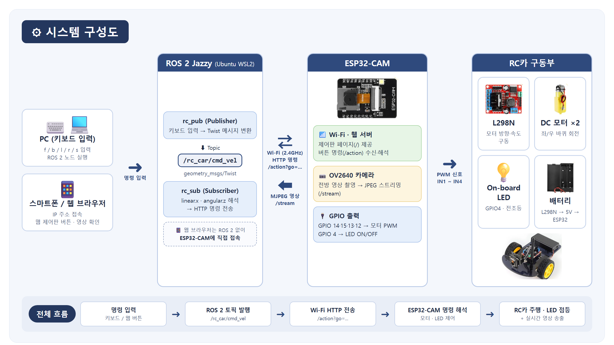

# ROS를 이용한 ESP32 RC카 동작 제어

## 1. 작품명

**ROS를 이용한 ESP32 RC카 동작 제어 (ESP32 RC Car Control with ROS 2)**

## 2. 작품설명

본 프로젝트는 **ROS 2를 이용하여 ESP32 RC카의 동작을 제어하는 것을 개발 목표로 한다.**

ESP32-CAM 보드는 Wi-Fi 통신, 카메라 영상 송출, 웹 서버 기능을 하나의 보드에서 제공한다. 이를 활용하여 PC의 ROS 2 노드나 스마트폰 웹 브라우저에서 무선으로 명령을 보내 RC카의 주행(전진·후진·좌회전·우회전·정지), 속도, LED를 제어하고, RC카 전방의 영상을 실시간으로 받아본다.

### 주요 기능

1. **Wi-Fi 제어**
   - ESP32-CAM에 내장된 Wi-Fi(2.4GHz)로 공유기에 접속하여 PC·스마트폰과 같은 네트워크에서 통신
   - 선 없이 HTTP 명령(`/action?go=forward` 등)만으로 모터와 LED를 원격으로 제어
   - ROS 2 노드가 `/rc_car/cmd_vel` 토픽을 받아 Wi-Fi 명령으로 변환하여 RC카에 전달

2. **실시간 영상 송출**
   - ESP32-CAM의 카메라 모듈(OV2640)로 RC카 전방 영상을 촬영
   - 영상을 JPEG 프레임으로 연속 전송(MJPEG 스트리밍, `/stream`)하여 브라우저에서 실시간 확인
   - 영상을 ROS 2 이미지 토픽으로 발행하면 객체 인식(YOLO) 등 영상 처리에 활용 가능

3. **웹페이지 & 원격 제어**
   - ESP32-CAM이 웹 서버를 실행하여, 브라우저에서 IP 주소로 접속하면 제어판이 표시됨
   - 제어판 하나에서 실시간 영상을 보면서 버튼으로 직진·후진·좌/우회전·정지, 가속·감속, LED ON/OFF 제어
   - 별도 앱 설치 없이 PC·스마트폰·태블릿 어디서나 원격 조종 가능

### 시스템 구성

#### 부품별 제어 방식

**① 주행 제어 (ESP32-CAM → L298N → DC 모터)**

ESP32-CAM은 L298N 모터 드라이버의 입력 핀(IN1~IN4)에 신호를 보내고, L298N이 배터리 전원으로 좌/우 DC 모터를 구동한다. 두 모터의 회전 방향 조합으로 RC카의 움직임이 결정된다.

| L298N 입력 | ESP32-CAM 핀 | 역할 |
|---|---|---|
| IN1 | GPIO14 | 오른쪽 모터 1 |
| IN2 | GPIO15 | 오른쪽 모터 2 |
| IN3 | GPIO13 | 왼쪽 모터 1 |
| IN4 | GPIO12 | 왼쪽 모터 2 |

| 동작 | 오른쪽 모터 | 왼쪽 모터 | 설명 |
|---|---|---|---|
| 직진 | 정회전 | 정회전 | 두 바퀴가 모두 앞으로 회전 |
| 후진 | 역회전 | 역회전 | 두 바퀴가 모두 뒤로 회전 |
| 좌회전 | 정회전 | 역회전 | 좌우 바퀴를 반대로 돌려 제자리 회전 |
| 우회전 | 역회전 | 정회전 | 좌우 바퀴를 반대로 돌려 제자리 회전 |
| 정지 | 정지 | 정지 | 모든 입력 핀 0 출력 |

**② 속도 제어 (PWM)**

입력 핀에 `analogWrite()`로 0~255 범위의 PWM 값을 출력한다. 값이 클수록 모터가 빨라지며, 제어판의 **가속(+) / 감속(-)** 버튼으로 이 값을 올리거나 내린다.

**③ LED 제어 (GPIO4)**

ESP32-CAM의 On-board LED는 GPIO4에 연결된 트랜지스터를 통해 켜진다. GPIO4가 HIGH이면 LED가 켜지고, LOW이면 꺼진다. GPIO 핀이 직접 낼 수 있는 전류가 작기 때문에 트랜지스터를 스위치로 사용한다.

**④ 실시간 영상 송출 (카메라 → 웹 서버)**

ESP32-CAM은 두 개의 HTTP 서버를 실행한다. 하나는 제어판 웹 페이지(`/`)와 제어 명령(`/action`)을 처리하고, 다른 하나는 카메라 영상 스트림(`/stream`)을 전송한다. 카메라에서 한 프레임씩 JPEG 이미지를 가져와 연속으로 보내는 MJPEG 방식으로 브라우저에 실시간 영상을 띄운다.

**⑤ 전원 공급**

배터리 전원은 L298N의 VDD(모터 구동 전원)로 들어가고, L298N의 5V 출력이 ESP32-CAM의 전원으로 공급된다.

## 3. 선정이유

본 프로젝트를 선정한 이유는 **ROS 2의 기본 통신 구조를 학습하면서, 이를 바탕으로 실제 하드웨어를 가지고 동작을 제어해 보기 위해서**이다.

ESP32 카메라 RC카는 Wi-Fi, 실시간 영상 송출, 웹 제어 기능을 갖추고 있어 PC의 ROS 2 노드와 무선으로 쉽게 연동할 수 있다. 또한 하드웨어 구성이 간단하여 제한된 프로젝트 기간 안에 구현하고 검증하기에 적합하며, 카메라 영상을 활용한 객체 인식 기반 자율주행 등으로 확장하기에도 좋은 플랫폼이다.

이를 통해 다음과 같은 내용을 학습하고자 한다.

- ROS 2의 Node, Topic, Publisher/Subscriber 구조 이해
- `geometry_msgs/msg/Twist` 메시지를 이용한 이동 명령 표현
- Wi-Fi(HTTP) 통신을 이용한 ROS 2와 ESP32 간 연동
- L298N 모터 드라이버와 PWM을 이용한 DC 모터 방향·속도 제어
- 카메라 영상 스트리밍(MJPEG)과 웹 서버 동작 원리

## 4. 필요기술

### 4.1 하드웨어

| 구성 요소 | 사용 목적 |
|---|---|
| ESP32-CAM 개발보드 | Wi-Fi 통신, 웹 서버 실행, 모터·LED 제어, 카메라 영상 제공 |
| ESP32-CAM 확장보드 | 코드 업로드(USB-시리얼) 및 핀 연결 |
| OV2640 카메라 모듈 | RC카 전방 실시간 영상 촬영 |
| 외장 안테나 | Wi-Fi 수신 감도 향상 |
| L298N 모터 드라이버 | ESP32 신호에 따라 DC 모터 방향·속도 구동 |
| DC 기어모터 ×2 (좌/우) | RC카 바퀴 구동 |
| 배터리 홀더 + 배터리 | 모터 및 보드 전원 공급 |
| 아크릴 차체, 바퀴 ×2, 범용 휠 | RC카 차체 구성 |
| PC (Windows + WSL2 Ubuntu) | ROS 2 노드 실행 |

### 4.2 소프트웨어

| 기술 | 사용 목적 |
|---|---|
| ROS 2 Jazzy | 노드 간 데이터 통신 및 시스템 구성 |
| C++ (rclcpp) / Python (rclpy) | ROS 2 Publisher/Subscriber 노드 구현 |
| Arduino IDE (C/C++) | ESP32-CAM 펌웨어 작성 및 업로드 |
| ESP32 라이브러리 (`WiFi.h`, `esp_camera.h`, `esp_http_server.h`) | Wi-Fi 연결, 카메라 제어, HTTP 웹 서버 |
| HTML / JavaScript | 웹 제어판 화면 및 버튼 동작 |
| colcon | ROS 2 패키지 빌드 |
| Ubuntu 24.04 (WSL2) | ROS 2 실행 환경 |

### 4.3 기능별 핵심 기술

**① Wi-Fi 통신 (STA 모드)**

`WiFi.begin(ssid, password)`로 ESP32-CAM을 공유기에 접속시키고(STA 모드), 할당받은 IP 주소로 PC와 스마트폰이 접근한다. ESP32는 2.4GHz Wi-Fi만 지원하므로 같은 2.4GHz 네트워크에 연결해야 한다.

**② HTTP 웹 서버와 원격 제어**

`esp_http_server`로 웹 서버를 실행하여, 제어판 페이지(`/`)를 보내고 버튼 명령(`/action?go=forward`, `backward`, `left`, `right`, `stop` 등)을 받아 처리한다. 웹 페이지의 버튼을 누르면 JavaScript가 해당 URL로 요청을 보낸다.

**③ MJPEG 실시간 영상 스트리밍**

`esp_camera`로 카메라 프레임을 JPEG으로 받아 `multipart/x-mixed-replace` 형식으로 연속 전송한다. 브라우저는 이를 하나의 동영상처럼 표시하며, ROS 2 노드에서도 같은 스트림을 받아 이미지 토픽으로 발행할 수 있다.

**④ PWM 기반 모터 제어**

L298N의 IN1~IN4 핀에 `analogWrite()`로 PWM 신호를 출력하여 좌/우 모터의 회전 방향과 속도를 제어한다. 두 모터의 방향 조합으로 직진·후진·좌회전·우회전·정지를 구현한다.

**⑤ GPIO 기반 LED 제어**

GPIO4에 HIGH/LOW를 출력하여 트랜지스터를 켜고 끄는 방식으로 On-board LED를 제어한다.

**⑥ ROS 2 Topic 통신**

Publisher 노드가 키보드 입력을 `geometry_msgs/msg/Twist` 메시지로 변환해 `/rc_car/cmd_vel` 토픽으로 발행하고, Subscriber 노드가 `linear.x`·`angular.z` 값을 해석하여 ESP32-CAM에 HTTP 명령으로 전달한다.

---

### 기대효과

ESP32 RC카를 ROS 2로 직접 제어해 보면서, **ROS 2의 Publisher/Subscriber 통신 구조가 Wi-Fi를 거쳐 실제 하드웨어(모터, LED, 카메라)의 동작으로 이어지는 전체 과정을 이해하는 것을 최종 목표로 한다.**

이를 통해 소프트웨어(ROS 2)에서 만든 명령이 마이크로컨트롤러(ESP32)에서 어떻게 해석되어 하드웨어를 움직이고, 반대로 하드웨어에서 얻은 영상 데이터가 어떻게 다시 소프트웨어로 전달·처리되는지를 경험할 수 있다. 나아가 이 구조를 바탕으로 카메라 영상 기반 객체 추적 등 자율주행 기능으로 확장할 수 있는 기반을 마련할 수 있다.
