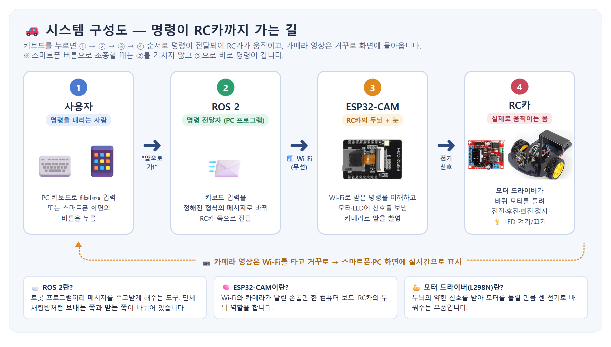

# ROS를 이용한 ESP32 RC카 동작 제어

## 1. 작품명

**ROS를 이용한 ESP32 RC카 동작 제어 (ESP32 RC Car Control with ROS 2)**

## 2. 작품설명

본 프로젝트는 **ESP32 RC카의 동작을 제어하는 것을 개발 목표로 한다.**

우리가 어릴 때 갖고 놀던 무선 조종 자동차(RC카)를 떠올리면 됩니다.
보통 RC카는 전용 리모컨으로 조종하지만, 이 프로젝트에서는 **컴퓨터와 스마트폰을 리모컨으로** 사용합니다.

- 컴퓨터 키보드에서 `f`(앞으로), `b`(뒤로), `l`(왼쪽), `r`(오른쪽), `s`(멈춤)를 누르면 RC카가 그대로 움직입니다.
- 스마트폰으로 RC카에 접속하면 화면에 **조종 버튼**과 **RC카가 보고 있는 영상**이 함께 나옵니다.

이때 컴퓨터의 명령을 RC카까지 전달하는 역할을 **ROS 2**가 맡습니다.

> 💡 **ROS 2가 뭔가요?**
> 로봇을 만들 때 쓰는 **프로그램끼리의 대화 도구**입니다.
> 단체 채팅방을 생각하면 쉽습니다. 한 프로그램이 채팅방에 "앞으로 가!"라고 메시지를 올리면(**보내는 쪽, Publisher**),
> 그 채팅방을 보고 있던 다른 프로그램이 메시지를 읽고 행동합니다(**받는 쪽, Subscriber**).
> 이 채팅방을 ROS 2에서는 **토픽(Topic)** 이라고 부릅니다.

### 주요 기능

1. **Wi-Fi 제어 — 선 없이 조종하기**
   - RC카에는 Wi-Fi가 들어 있어서, 컴퓨터·스마트폰과 **같은 Wi-Fi(공유기)에 연결**됩니다.
   - 그래서 케이블을 꽂지 않아도 멀리서 명령을 보낼 수 있습니다.
   - 컴퓨터에서 보낸 ROS 2 명령도 이 Wi-Fi를 타고 RC카에 전달됩니다.

2. **실시간 영상 송출 — RC카의 눈으로 보기**
   - RC카 앞에 **작은 카메라**가 달려 있습니다.
   - 카메라가 찍은 장면을 Wi-Fi로 계속 보내서, 스마트폰이나 컴퓨터 화면에서 **RC카 시점의 영상을 실시간으로** 볼 수 있습니다.
   - 덕분에 RC카가 눈앞에 없어도 영상을 보면서 조종할 수 있습니다.

3. **웹페이지 & 원격 제어 — 앱 없이 스마트폰으로 조종하기**
   - RC카가 직접 **작은 웹사이트**를 띄워 줍니다.
   - 스마트폰 인터넷 창(크롬 등)에 RC카 주소를 입력하면, 아래와 같은 조종 화면이 나옵니다.
   - 별도의 앱을 설치할 필요가 없습니다.

   | 버튼 | 하는 일 |
   |---|---|
   | ↑ / ↓ | 앞으로 / 뒤로 가기 |
   | ← / → | 왼쪽 / 오른쪽으로 돌기 |
   | ● | 멈추기 |
   | + / − | 빨라지기 / 느려지기 |
   | ON / OFF | 불(LED) 켜기 / 끄기 |
   | 화면 위쪽 | RC카 카메라 실시간 영상 |

### 시스템 구성

#### 명령이 전달되는 순서 (예: 키보드로 `f`를 눌렀을 때)

| 순서 | 어디서 | 무슨 일이 일어나나 |
|---|---|---|
| ① | **사용자 (PC 키보드)** | `f` 키를 누른다. |
| ② | **ROS 2 (PC 프로그램)** | 보내는 프로그램이 `f`를 "앞으로 가"라는 **약속된 형식의 메시지**로 바꿔 토픽(채팅방)에 올린다. 받는 프로그램이 이를 읽고 Wi-Fi로 RC카에 전달한다. |
| ③ | **ESP32-CAM (RC카의 두뇌)** | Wi-Fi로 "앞으로"라는 명령을 받고, 모터 쪽에 "바퀴를 앞으로 돌려"라는 전기 신호를 보낸다. |
| ④ | **모터 드라이버 + 바퀴 (RC카의 몸)** | 모터 드라이버가 신호를 받아 양쪽 바퀴 모터를 앞으로 돌린다. → **RC카가 앞으로 간다!** |

그리고 반대 방향으로는, **RC카의 카메라 영상이 Wi-Fi를 타고 스마트폰·PC 화면으로 계속 전송**됩니다.

#### RC카는 어떻게 방향을 바꿀까?

이 RC카는 운전대가 없고, **왼쪽 바퀴와 오른쪽 바퀴를 따로** 돌려서 방향을 바꿉니다. (탱크나 휠체어와 같은 원리)

| 동작 | 왼쪽 바퀴 | 오른쪽 바퀴 |
|---|---|---|
| 앞으로 | 앞으로 ⬆ | 앞으로 ⬆ |
| 뒤로 | 뒤로 ⬇ | 뒤로 ⬇ |
| 왼쪽으로 돌기 | 뒤로 ⬇ | 앞으로 ⬆ |
| 오른쪽으로 돌기 | 앞으로 ⬆ | 뒤로 ⬇ |
| 멈춤 | 멈춤 | 멈춤 |

- **속도 조절**: 모터에 주는 전기를 아주 빠르게 켰다 껐다 하면서, 켜져 있는 시간을 늘리면 빨라지고 줄이면 느려집니다. (이 방법을 **PWM**이라고 합니다.)
- **불(LED) 켜기**: RC카 두뇌(ESP32-CAM)에 붙어 있는 작은 LED에 전기를 보내면 켜지고, 끊으면 꺼집니다. 어두운 곳에서 전조등처럼 쓸 수 있습니다.

## 3. 선정이유

본 프로젝트를 선정한 이유는 **ROS 2의 기본 통신 구조를 학습하면서, 이를 바탕으로 실제 하드웨어를 가지고 동작을 제어해 보기 위해서**이다.

수업에서는 컴퓨터 화면 속 거북이 그림(turtlesim)을 키보드로 움직이며 ROS 2를 배웠습니다.
하지만 화면 속에서만 움직이는 것과 **실제 물건이 눈앞에서 움직이는 것**은 다릅니다.
그래서 배운 내용을 실제 RC카에 적용해, **"내가 보낸 메시지가 진짜 바퀴를 굴린다"** 는 것을 직접 확인해 보고 싶었습니다.

ESP32 카메라 RC카를 고른 이유는 다음과 같습니다.

- **Wi-Fi가 내장**되어 있어 컴퓨터(ROS 2)와 무선으로 쉽게 연결할 수 있다.
- **카메라가 달려 있어** 조종뿐 아니라 영상까지 다룰 수 있다.
- 부품이 간단하고 저렴해서 **짧은 프로젝트 기간 안에 완성**하기 좋다.
- 나중에 카메라로 사람·물체를 알아보고 **스스로 따라가는 자율주행**으로 발전시킬 수 있다.

## 4. 필요기술

### 4.1 하드웨어 (사용한 부품)

| 부품 | 쉽게 말하면 | 하는 일 |
|---|---|---|
| ESP32-CAM | RC카의 **두뇌 + 눈** | Wi-Fi로 명령을 받고, 모터·LED를 조종하고, 카메라로 앞을 촬영 |
| L298N 모터 드라이버 | RC카의 **근육** | 두뇌의 약한 신호를 받아 모터를 돌릴 만큼 센 전기로 바꿔줌 |
| DC 모터 2개 + 바퀴 | RC카의 **다리** | 왼쪽·오른쪽 바퀴를 각각 돌림 |
| 배터리 | RC카의 **밥** | 모터와 두뇌에 전기를 공급 |
| 안테나 | RC카의 **귀** | Wi-Fi 신호를 더 잘 받게 해줌 |
| 아크릴 차체 | RC카의 **몸통** | 부품을 올려 고정 |
| PC (노트북) | **조종석** | ROS 2 프로그램을 실행하고 키보드로 명령 입력 |

### 4.2 소프트웨어 (사용한 프로그램)

| 프로그램 | 하는 일 |
|---|---|
| ROS 2 | 프로그램끼리 메시지를 주고받게 해주는 로봇용 통신 도구 |
| Ubuntu (리눅스) | ROS 2가 돌아가는 컴퓨터 운영체제 (Windows 안에서 WSL로 실행) |
| C++ / Python | ROS 2 프로그램(보내는 쪽·받는 쪽)을 만드는 프로그래밍 언어 |
| Arduino IDE | RC카 두뇌(ESP32-CAM)에 들어갈 프로그램을 만들고 넣어주는 도구 |
| HTML / JavaScript | 스마트폰에 보이는 조종 화면(웹페이지)을 만드는 언어 |

### 4.3 기능을 만드는 핵심 기술

**① Wi-Fi 연결 — "같은 공유기에 접속하기"**

RC카 두뇌(ESP32-CAM)를 집이나 학교의 Wi-Fi 공유기에 접속시킵니다.
그러면 RC카도 스마트폰처럼 **고유한 주소(IP 주소)** 를 하나 받게 되고, 같은 Wi-Fi에 있는 컴퓨터·스마트폰이 그 주소로 RC카에 말을 걸 수 있습니다.

**② 웹 서버 — "RC카가 직접 웹사이트를 띄우기"**

RC카 두뇌 안에서 아주 작은 웹사이트를 실행합니다.
스마트폰에서 RC카 주소로 접속하면 조종 화면이 열리고, 버튼을 누를 때마다 "앞으로", "멈춰" 같은 명령이 RC카로 전송됩니다.

**③ 실시간 영상 전송 — "사진을 빠르게 넘겨서 영상처럼 보여주기"**

카메라가 사진을 1초에 여러 장 찍어서 쉬지 않고 보냅니다.
화면에서는 이 사진들이 빠르게 바뀌면서 **동영상처럼** 보입니다. (만화책을 빠르게 넘기는 것과 같은 원리, 이 방식을 **MJPEG**이라고 합니다.)

**④ 모터 제어 — "바퀴 방향과 속도 정하기"**

두뇌가 모터 드라이버에 "왼쪽 바퀴는 앞으로, 오른쪽 바퀴는 뒤로" 같은 신호를 보내 방향을 정하고,
전기를 주는 세기(PWM)로 속도를 조절합니다.

**⑤ LED 제어 — "스위치 켜고 끄기"**

두뇌의 LED 연결 핀에 전기를 보내면 LED가 켜지고, 끊으면 꺼집니다. 방 스위치를 켜고 끄는 것과 같습니다.

**⑥ ROS 2 통신 — "채팅방에 명령 올리기"**

- **보내는 프로그램(Publisher)**: 키보드 입력을 받아 "앞으로 얼마만큼, 회전 얼마만큼"이라는 **정해진 형식의 메시지**로 바꿔 채팅방(토픽 `/rc_car/cmd_vel`)에 올립니다.
- **받는 프로그램(Subscriber)**: 그 채팅방을 계속 지켜보다가 메시지가 오면 읽고, Wi-Fi로 RC카에 "앞으로 가" 명령을 전달합니다.

---

### 기대효과

이 프로젝트를 통해 **ESP32라는 작은 컴퓨터 보드가 실제 부품(모터, LED, 카메라)을 어떻게 움직이는지**,
그리고 **ROS 2가 프로그램 사이에서 명령을 어떻게 주고받는지**를 함께 이해하는 것을 최종 목표로 한다.

즉, **"컴퓨터에서 키 하나를 누르면 → ROS 2가 메시지로 전달하고 → Wi-Fi를 거쳐 → ESP32가 알아듣고 → 실제 바퀴가 굴러간다"** 는
소프트웨어에서 하드웨어까지의 전체 흐름을 직접 만들고 눈으로 확인할 수 있다.

또한 반대로 **RC카 카메라의 영상이 다시 컴퓨터로 돌아오는 과정**까지 다뤄 보면서,
앞으로 카메라로 물체를 알아보고 스스로 움직이는 **자율주행 로봇**으로 발전시킬 수 있는 기초를 마련할 수 있다.
