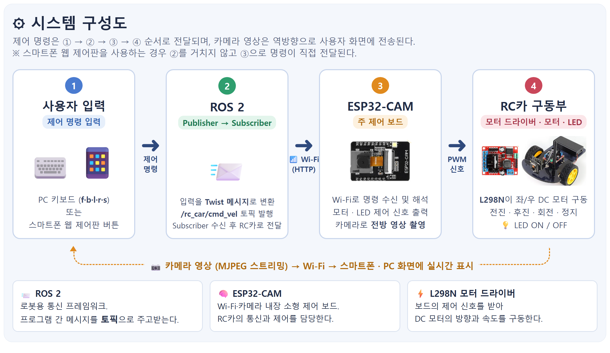

# ROS를 이용한 ESP32 RC카 동작 제어

## 1. 작품명

**ROS를 이용한 ESP32 RC카 동작 제어 (ESP32 RC Car Control with ROS 2)**

## 2. 작품설명

본 프로젝트는 **ROS 2를 이용하여 ESP32 RC카의 동작을 제어하는 것을 개발 목표로 한다.**

사용자가 PC 키보드나 스마트폰으로 명령을 입력하면, 명령이 Wi-Fi를 통해 RC카에 전달되어 **주행(전진·후진·좌회전·우회전·정지), 속도 조절, LED 점등**이 이루어진다. 동시에 RC카에 장착된 카메라의 영상이 사용자 화면에 실시간으로 전송된다.

PC에서 RC카까지 명령을 전달하는 과정에는 **ROS 2**를 사용한다. ROS 2(Robot Operating System 2)는 로봇 소프트웨어 개발에 사용되는 통신 프레임워크로, 여러 프로그램(노드)이 **토픽(Topic)** 이라는 통로를 통해 메시지를 주고받는다. 메시지를 보내는 쪽을 **Publisher**, 받는 쪽을 **Subscriber**라고 한다.

### 주요 기능

1. **Wi-Fi 제어**
   - ESP32-CAM에 내장된 Wi-Fi를 이용하여 PC·스마트폰과 무선으로 연결
   - 케이블 없이 원거리에서 RC카의 주행과 LED를 제어
   - ROS 2에서 발행한 명령을 Wi-Fi를 통해 RC카에 전달

2. **실시간 영상 송출**
   - RC카 전방에 장착된 카메라로 주행 영상을 촬영
   - 촬영한 영상을 Wi-Fi로 연속 전송하여 PC·스마트폰 화면에서 실시간으로 확인
   - RC카가 시야 밖에 있어도 영상을 보며 원격 조종 가능

3. **웹페이지 & 원격 제어**
   - ESP32-CAM이 자체 웹 서버를 실행하여 조종용 웹페이지 제공
   - 별도의 앱 설치 없이 스마트폰 브라우저에서 RC카 IP 주소로 접속하여 제어
   - 하나의 화면에서 실시간 영상 확인과 주행·속도·LED 제어 가능

   | 웹 제어판 버튼 | 기능 |
   |---|---|
   | ↑ / ↓ | 전진 / 후진 |
   | ← / → | 좌회전 / 우회전 |
   | ● | 정지 |
   | + / − | 가속 / 감속 |
   | ON / OFF | LED 켜기 / 끄기 |

### 시스템 구성

**동작 흐름 (키보드로 전진 명령을 보내는 경우)**

| 단계 | 구성 요소 | 동작 |
|---|---|---|
| ① | 사용자 입력 | PC 키보드에서 `f`(전진) 입력 |
| ② | ROS 2 | Publisher 노드가 입력을 이동 명령 메시지(`Twist`)로 변환하여 `/rc_car/cmd_vel` 토픽으로 발행하고, Subscriber 노드가 이를 수신하여 Wi-Fi로 RC카에 전달 |
| ③ | ESP32-CAM | Wi-Fi로 수신한 명령을 해석하여 모터 드라이버에 제어 신호 출력 |
| ④ | RC카 구동부 | L298N 모터 드라이버가 좌/우 DC 모터를 회전시켜 RC카가 전진 |

카메라 영상은 반대 방향으로 ESP32-CAM에서 Wi-Fi를 거쳐 사용자 화면에 전송된다.

**주행 방향 제어 방식**

RC카는 별도의 조향 장치 없이 **좌/우 바퀴의 회전 방향을 다르게 하여** 방향을 전환한다.

| 동작 | 왼쪽 바퀴 | 오른쪽 바퀴 |
|---|---|---|
| 전진 | 정회전 | 정회전 |
| 후진 | 역회전 | 역회전 |
| 좌회전 | 역회전 | 정회전 |
| 우회전 | 정회전 | 역회전 |
| 정지 | 정지 | 정지 |

## 3. 선정이유

본 프로젝트를 선정한 이유는 **ROS 2의 기본 통신 구조를 학습하면서, 이를 바탕으로 실제 하드웨어를 가지고 동작을 제어해 보기 위해서**이다.

수업에서는 시뮬레이터(turtlesim) 화면 속 거북이를 키보드로 움직이며 ROS 2의 Publisher/Subscriber 구조를 실습하였다. 이를 실제 하드웨어에 적용하여, ROS 2에서 발행한 메시지가 실제 장치의 동작으로 이어지는 과정을 직접 확인하고자 하였다.

ESP32 카메라 RC카는 Wi-Fi와 카메라가 내장되어 있어 PC의 ROS 2와 무선으로 쉽게 연동할 수 있고, 하드웨어 구성이 간단하여 제한된 프로젝트 기간 안에 구현하고 검증하기에 적합하다. 또한 카메라 영상을 활용한 객체 인식·자율주행 등으로 기능을 확장하기에도 좋은 플랫폼이다.

이를 통해 다음과 같은 기술을 학습하고자 한다.

- ROS 2의 Node, Topic, Publisher/Subscriber 구조 이해
- Wi-Fi 통신을 이용한 ROS 2와 ESP32 간 연동
- 모터 드라이버를 이용한 DC 모터의 방향 및 속도 제어
- 카메라 영상의 실시간 전송 원리
- 웹 서버를 이용한 원격 제어 인터페이스 구성

## 4. 필요기술

### 4.1 하드웨어

| 구성 요소 | 사용 목적 |
|---|---|
| ESP32-CAM | RC카의 주 제어 보드. Wi-Fi 통신, 모터·LED 제어, 카메라 영상 촬영 |
| L298N 모터 드라이버 | ESP32-CAM의 제어 신호에 따라 DC 모터 구동 |
| DC 기어모터 ×2 | 좌/우 바퀴 구동 |
| 배터리 | 모터 및 보드 전원 공급 |
| 외장 안테나 | Wi-Fi 수신 감도 향상 |
| 아크릴 차체, 바퀴 | RC카 본체 구성 |
| PC | ROS 2 노드 실행 및 키보드 명령 입력 |

### 4.2 소프트웨어

| 기술 | 사용 목적 |
|---|---|
| ROS 2 | 노드 간 메시지 통신 및 시스템 구성 |
| Ubuntu (WSL2) | ROS 2 실행 환경 |
| C++ / Python | ROS 2 Publisher/Subscriber 노드 구현 |
| HTML / JavaScript | 웹 제어판 화면 구성 |

### 4.3 핵심 구현 기술

**① Wi-Fi 통신**

ESP32-CAM을 공유기에 접속시켜 IP 주소를 할당받고, 같은 네트워크에 있는 PC·스마트폰이 해당 IP 주소로 RC카에 명령을 전송한다.

**② 웹 서버 기반 원격 제어**

ESP32-CAM 내부에서 웹 서버를 실행하여 조종용 웹페이지를 제공한다. 사용자가 버튼을 누르면 해당 명령(전진, 정지 등)이 RC카로 전송된다.

**③ 실시간 영상 스트리밍**

카메라로 촬영한 이미지를 JPEG 형식으로 연속 전송하는 **Motin JPEG** 방식을 사용한다. 연속된 이미지가 빠르게 갱신되면서 화면에서는 동영상처럼 표시된다.

**④ PWM 기반 모터 제어**

L298N 모터 드라이버에 신호를 보내 좌/우 모터의 회전 방향을 결정하고, **PWM**(전압을 빠르게 켜고 끄는 비율을 조절하는 방식)으로 모터의 속도를 조절한다.

**⑤ LED 제어**

ESP32-CAM에 내장된 LED의 제어 핀에 신호를 출력하여 LED를 켜고 끈다.

**⑥ ROS 2 Topic 통신**

Publisher 노드가 키보드 입력을 이동 명령 메시지(`geometry_msgs/msg/Twist`)로 변환하여 `/rc_car/cmd_vel` 토픽으로 발행한다. Subscriber 노드는 이 토픽을 구독하여 메시지를 해석하고, Wi-Fi를 통해 ESP32-CAM에 명령을 전달한다.

---

### 기대효과

본 프로젝트를 통해 ESP32 기반 RC카를 ROS 2로 제어하는 시스템을 구현하고, **ROS 2에서 발행한 명령이 Wi-Fi를 거쳐 ESP32에서 처리되고 실제 모터와 LED의 동작으로 이어지는 과정**을 학습하고자 한다.

이를 통해 ROS 2의 통신 구조와 ESP32의 하드웨어 제어 및 데이터 처리 과정을 함께 이해하는 것을 최종 목표로 하며, 나아가 카메라 영상을 활용한 객체 인식 기반 자율주행으로 확장할 수 있는 기반을 마련하고자 한다.
